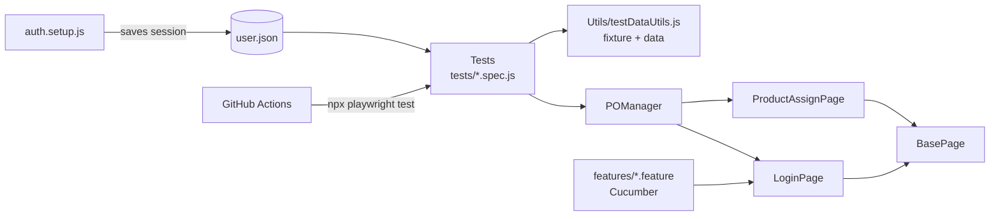

# Playwright E-Commerce Automation Framework (JavaScript)

- Author - Satyanarayana, Software Test Engineer
- Application under test - [automationexercise.com](https://automationexercise.com)

## Tech Stack

- Playwright Test, JavaScript (Node.js)
- Page Object Model (`BasePage` + `POManager`)
- Data-driven testing (test data array + custom fixture)
- Login once, reuse session (`storageState`)
- Cucumber (BDD) with Playwright
- dotenv for credentials, GitHub Secrets in CI
- GitHub Actions CI, HTML report, screenshot and trace on failure

## Framework Design



## What Is Covered

- End-to-end purchase: login, select product, cart, checkout, payment, order confirmation
- Data-driven negative login tests
- Storefront checks: home, products, search, product details, category, brand, cart, subscription, logout
- BDD scenario for invalid login

## Project Structure

```
pages/        Page objects (BasePage, LoginPage, ProductAssignPage, POManager)
tests/        Playwright specs and auth.setup.js
Utils/        Test data and custom fixture
features/     Cucumber feature, steps, hooks
.github/      CI workflow
```

## How to Run

```bash
npm ci
npx playwright install chromium
```

Create a `.env` file:

```env
BASE_URL=https://automationexercise.com
TEST_USERNAME=your_email
TEST_PASSWORD=your_password
```

```bash
npx playwright test            # run all tests
npx playwright show-report     # open HTML report
npm run test:cucumber          # run BDD scenarios
```

## CI

GitHub Actions runs the suite on pull requests to `main` and on `feature/**` pushes, then uploads the HTML report as an artifact.
